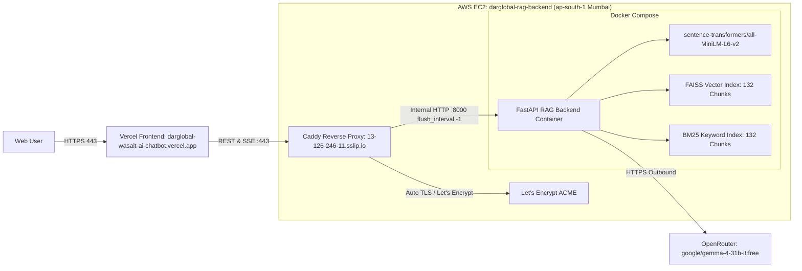

# DarGlobal & Wasalt Real Estate AI Chatbot

A production-grade, full-stack conversational AI platform providing hybrid retrieval-augmented generation (RAG) across verified knowledge bases for **DarGlobal PLC** (luxury international real estate) and **Wasalt** (Saudi Arabia real estate marketplace & auctions).

- **Live Production App**: [https://darglobal-wasalt-ai-chatbot.vercel.app](https://darglobal-wasalt-ai-chatbot.vercel.app)
- **Live Backend API**: [https://13-126-246-11.sslip.io](https://13-126-246-11.sslip.io)
- **Interactive Swagger Docs**: [https://13-126-246-11.sslip.io/docs](https://13-126-246-11.sslip.io/docs)

---

## 1. System Architecture



---

## 2. Repository Structure

```text
darglobal-wasalt-ai-chatbot/
├── frontend/                     # TanStack Start / React modern real-estate UI
│   ├── public/                   # Favicons, brand icons, and static assets
│   ├── src/
│   │   ├── components/           # Real-estate UI components & AI chat interface
│   │   ├── hooks/                # Responsive & state hooks
│   │   ├── lib/                  # API client (src/lib/api.ts) & utilities
│   │   ├── routes/               # File-based routing (/, /chat, /about, /sources)
│   │   └── styles.css            # Tailwind CSS design system
│   ├── package.json              # Frontend scripts & dependencies
│   ├── vite.config.ts            # Vite build configuration
│   ├── tsconfig.json             # TypeScript configuration
│   └── .env.example              # Frontend environment template
├── backend/                      # Production FastAPI Hybrid RAG Backend
│   ├── app/
│   │   ├── main.py               # FastAPI app, CORS, routes & lifespan handler
│   │   ├── config.py             # App settings and environment loading
│   │   ├── hybrid_retriever.py   # RRF fusion of dense and keyword search
│   │   ├── embeddings.py         # SentenceTransformers embedding pipeline
│   │   ├── vector_store.py       # FAISS IndexFlatIP inner product index
│   │   ├── bm25_search.py        # BM25 Okapi search engine
│   │   ├── chunker.py            # Structure-aware document chunker
│   │   ├── indexer.py            # Index generation & audit CLI
│   │   ├── openrouter_client.py  # LLM client with SSE streaming & fallback
│   │   └── models.py             # Pydantic schemas for requests/responses
│   ├── data/
│   │   ├── DARGLOBAL_VERIFIED_DATA.md  # Ground truth DarGlobal corpus
│   │   ├── WASALT_VERIFIED_DATA.md     # Ground truth Wasalt corpus
│   │   ├── chunks.json                 # 132 structured knowledge chunks
│   │   ├── faiss_index.bin             # Serialized FAISS vector index (384-dim)
│   │   └── bm25_index.pkl              # Serialized BM25 keyword index
│   ├── tests/
│   │   └── test_suite.py         # 15 automated unit & integration tests
│   ├── Dockerfile                # CPU-optimized multi-stage Docker container
│   ├── docker-compose.yml        # Docker Compose with Caddy auto-SSL proxy
│   ├── Caddyfile                 # Caddy reverse proxy with SSE flush interval
│   ├── requirements.txt          # Pinned Python dependencies
│   ├── .dockerignore             # Docker build exclusions
│   └── .env.example              # Backend environment template
├── .gitignore                    # Comprehensive secrets & artifact exclusions
└── README.md                     # Root project documentation
```

---

## 3. Quick Start (Local Development)

### Prerequisites
- Node.js 18+ & npm
- Python 3.12+
- Docker Desktop (optional, for containerized run)

### Running the Backend Locally
1. Navigate to the backend directory:
   ```bash
   cd backend
   ```
2. Create and activate a virtual environment:
   ```bash
   python -m venv .venv
   # Windows:
   .venv\Scripts\activate
   # Linux/macOS:
   source .venv/bin/activate
   ```
3. Install dependencies:
   ```bash
   pip install -r requirements.txt
   ```
4. Configure environment variables:
   ```bash
   cp .env.example .env
   # Add your OpenRouter API key inside .env
   ```
5. Start the development server:
   ```bash
   uvicorn app.main:app --host 0.0.0.0 --port 8000 --reload
   ```
   Backend will be live at `http://localhost:8000` with Swagger docs at `http://localhost:8000/docs`.

### Running the Frontend Locally
1. In a separate terminal, navigate to the frontend directory:
   ```bash
   cd frontend
   ```
2. Install dependencies:
   ```bash
   npm install
   ```
3. Configure environment variables (optional, defaults to live backend):
   ```bash
   cp .env.example .env.local
   # Set VITE_API_BASE_URL=http://localhost:8000 for local backend
   ```
4. Start Vite development server:
   ```bash
   npm run dev
   ```
   Open `http://localhost:3000` or `http://localhost:5173` in your browser.

---

## 4. Production Deployment

### Frontend Deployment (Vercel)
The frontend is deployed to Vercel connected to this GitHub repository.

> **IMPORTANT: Vercel Root Directory Requirement**
> Because this repository contains both frontend and backend in a monorepo structure, configure Vercel as follows:
> 1. In your **Vercel Dashboard**, select the `darglobal-wasalt-ai-chatbot` project.
> 2. Navigate to **Settings** > **General**.
> 3. Under **Root Directory**, click **Edit**, enter **`frontend`**, and click **Save**.
> 4. In **Environment Variables**, ensure:
>    ```text
>    VITE_API_BASE_URL = https://13-126-246-11.sslip.io
>    ```
> 5. Trigger a deployment. Subsequent commits pushed to `main` will automatically build from `frontend/`.

### Backend Deployment (AWS EC2 + Docker)
The backend runs containerized on an AWS EC2 instance (`t3.small`, Ubuntu 24.04 LTS) in `ap-south-1` (Mumbai).

1. Connect to EC2 via SSH:
   ```bash
   ssh -i /path/to/darglobal-rag-key.pem ubuntu@13.126.246.11
   ```
2. Application directory on EC2:
   ```bash
   cd /home/ubuntu/app
   ```
3. Launch with Docker Compose:
   ```bash
   docker compose up -d --build
   ```
   Caddy automatically manages Let's Encrypt SSL certificates for `13-126-246-11.sslip.io`.

---

## 5. API Endpoints

| Endpoint | Method | Description |
| :--- | :---: | :--- |
| `/health` | `GET` | Health check returning indexed chunk count, active embedding model, and LLM configuration. |
| `/sources` | `GET` | Document breakdown across DarGlobal and Wasalt categories. |
| `/chat` | `POST` | Grounded hybrid RAG conversation with citation links and latency breakdown. |
| `/chat/stream` | `POST` | Real-time Server-Sent Events (SSE) token streaming. |
| `/search` | `POST` | Raw hybrid search (BM25 + FAISS + RRF) returning top-k chunk matches. |

### Sample Chat Request
```bash
curl -X POST https://13-126-246-11.sslip.io/chat \
  -H "Content-Type: application/json" \
  -d '{"message": "What is DarGlobal?", "company": "darglobal"}'
```

---

## 6. Security & Best Practices

- **Zero Secrets in Git**: All `.env` files, API keys, credentials, and private `.pem` SSH keys are strictly excluded via `.gitignore`.
- **Placeholder Templates**: Clean `.env.example` templates are provided in both `frontend/` and `backend/`.
- **Container Isolation**: Backend runs in an unprivileged Docker network with Caddy handling SSL termination on ports 80/443. Port 8000 is internal-only.
